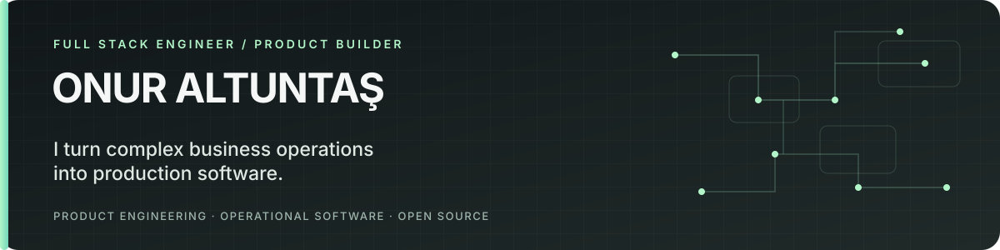

  

  <a href="https://altuntasonur.com">Portfolio</a> ·
  <a href="https://linkedin.com/in/onur-altuntas99">LinkedIn</a> ·
  <a href="https://github.com/Onurlulardan">GitHub</a>

I build software end to end — from domain modeling and data architecture to APIs, user interfaces, integrations, deployment, and production reliability. My focus is **operational software that solves real business problems**.

<table>
  <tr>
    <td width="33%" valign="top">
      <strong>PRODUCT BUILDER</strong> 
      Built <a href="https://forgecrud.io">ForgeCRUD</a>, an on-premise low-code operations platform for configurable workflows and business processes.
    </td>
    <td width="33%" valign="top">
      <strong>ENTERPRISE SOFTWARE</strong> 
      Worked on enterprise business-process applications at Bimser and full-stack applications at DATARUL.
    </td>
    <td width="33%" valign="top">
      <strong>OPEN SOURCE</strong> 
      Built <a href="https://github.com/Onurlulardan/ForgeStart">ForgeStart</a> and <a href="https://github.com/Onurlulardan/react-lookup-select">react-lookup-select</a>.
    </td>
  </tr>
</table>

## Selected Work

<table>
  <tr>
    <td width="50%" valign="top">
      <h3><a href="https://forgecrud.io">ForgeCRUD</a></h3>
      <strong>On-premise operations platform</strong>  
      Dynamic forms, workflows, dashboards, access control, and configurable modules for CRM, inventory, purchasing, finance, HR, and other operational processes.  
      <code>Product ownership</code> <code>On-premise</code>
    </td>
    <td width="50%" valign="top">
      <h3><a href="https://github.com/Onurlulardan/ForgeStart">ForgeStart</a></h3>
      <strong>Open-source full-stack starter</strong>  
      A Next.js foundation with Auth.js, Drizzle, PostgreSQL, RBAC, organization management, audit logs, Docker, and testing infrastructure.  
      <code>Open source</code> <code>Next.js</code>
    </td>
  </tr>
  <tr>
    <td width="50%" valign="top">
      <h3><a href="https://github.com/Onurlulardan/react-lookup-select">react-lookup-select</a></h3>
      <strong>Reusable React component</strong>  
      A headless, customizable lookup/select component with grid-based single and multiple selection.  
      <code>Open source</code> <code>React</code>
    </td>
    <td width="50%" valign="top">
      <h3>ForgeGuard</h3>
      <strong>Private deployment tooling</strong>  
      Tooling for licensing, release management, image mirroring, and update automation for on-premise software delivery.  
      <code>Deployment</code> <code>Platform engineering</code>
    </td>
  </tr>
</table>

## Engineering Focus

- **End-to-end ownership:** I work across data models, APIs, user interfaces, integrations, and deployment.
- **Business-driven design:** Workflows, permissions, and domain models should reflect how teams actually operate.
- **Production-minded engineering:** Reliability, maintainability, and performance are part of the product.

## Core Toolkit

`Go` `TypeScript` `JavaScript` `React` `Next.js` `.NET Core` `PostgreSQL` `SQL Server` `Docker` `Redis` `RabbitMQ`

---

  <strong>Business problems → working software → production.</strong> 
  <a href="https://altuntasonur.com">Portfolio</a> ·
  <a href="https://linkedin.com/in/onur-altuntas99">LinkedIn</a>

